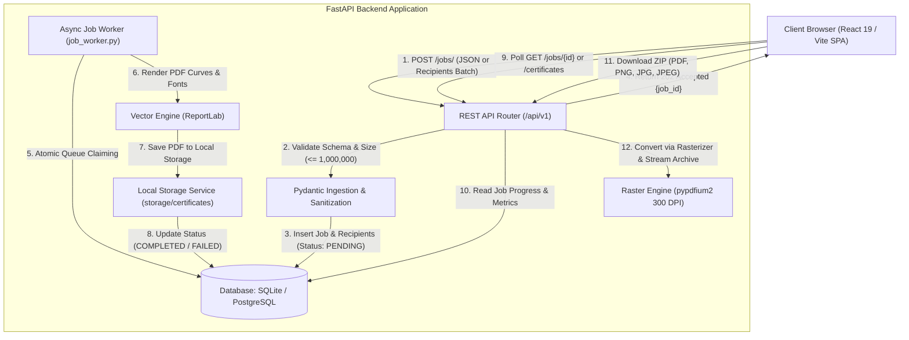
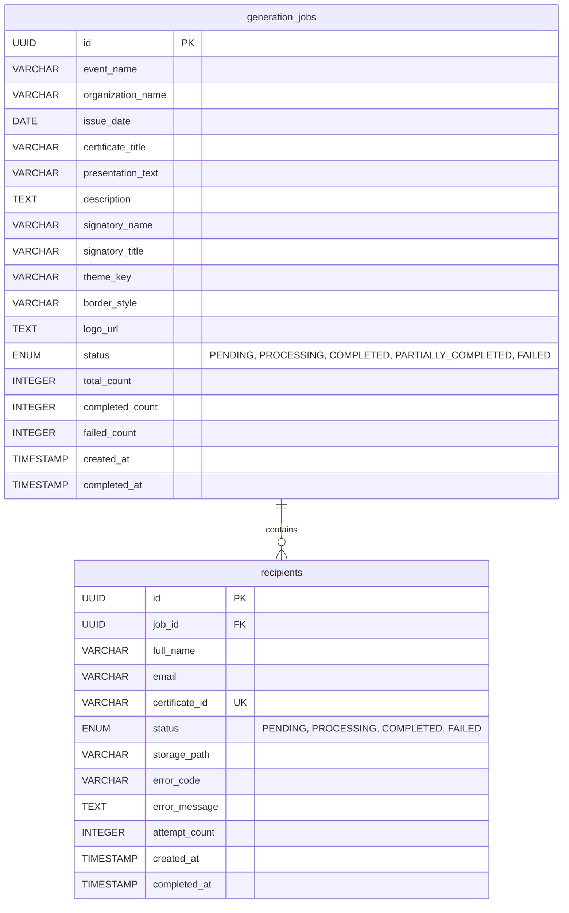

# Bulk Certificate Generator

[](https://fastapi.tiangolo.com)
[](https://react.dev)
[](https://vitejs.dev)
[](https://www.python.org)
[](https://www.reportlab.com)
[](https://pytest.org)
[](LICENSE)

An enterprise-grade, fault-tolerant bulk credential and certificate issuance platform. It generates high-fidelity vector PDF certificates, high-resolution 300 DPI raster images (PNG, JPG, JPEG), and batch ZIP archives asynchronously at scale—supporting up to **1,000,000 (1 Million) recipients** per issuance batch with real-time interactive previews and live tracking.

---

## Table of Contents
1. [Key Features & Highlights](#key-features--highlights)
2. [Interactive Preview & Theming Studio](#interactive-preview--theming-studio)
3. [System Architecture](#system-architecture)
4. [Data Flow & Lifecycle](#data-flow--lifecycle)
5. [Database Schema & Models](#database-schema--models)
6. [API Reference & Contracts](#api-reference--contracts)
7. [Local Setup & Installation](#local-setup--installation)
8. [Testing & Quality Assurance](#testing--quality-assurance)
9. [Environment Variables Reference](#environment-variables-reference)
10. [Troubleshooting & FAQs](#troubleshooting--faqs)

---

## Key Features & Highlights

- **High-Throughput Scalability (Up to 1,000,000 Certificates)**: Engineered to ingest and process massive batches without API request timeouts or memory exhaustion.
- **True WYSIWYG Visual Preview**: Interactive canvas in the frontend that reflects typography, fonts, border accents, dynamic underlines, and official medallions **1:1** with downloaded outputs.
- **Multi-Format Export Engine**:
  - **Vector PDF**: Crisp, mathematical vector curves rendered via ReportLab.
  - **300 DPI Lossless PNG**: Razor-sharp digital graphic export via `pypdfium2`.
  - **300 DPI High-Quality JPEG / JPG**: Universal image formats for web sharing and printing.
  - **Batch ZIP Archives**: Streamed archive generation with unique naming and progress feedback.
- **Asynchronous Fault-Tolerant Worker**:
  - Worker process uses atomic database queue claiming (`FOR UPDATE SKIP LOCKED` on PostgreSQL, thread-safe transactional lock on SQLite).
  - Individual recipient failures (e.g. malformed names or transient storage errors) do not fail the overall batch.
  - Automatic retry policy (up to 3 retries) with isolated failure recording.
- **Pre-Built Template Presets**:
  - **Bootcamp Completion**: Modern engineering certifications.
  - **AI Hackathon Champion**: Vibrant hackathon badges with gold awards.
  - **Executive Leadership**: Corporate governance and director-level certificates.
  - **Academic Distinction**: Classic collegiate diplomas and university honors.
- **5 Curated Color Themes**: Classic Navy & Gold, Emerald Prestige, Crimson & Burgundy, Sapphire & Steel, and Monochrome Slate.
- **5 Perimeter Border Frame Architectures**: Classic Heritage, Executive Dual-Line, Architectural Gold, Royal Heraldic, and Clean Minimalist.
- **Official Security Seals & Institutional Crests**: 36-point scalloped gold rosettes, faceted 3D compass stars, laurel leaves, authentic verified banners, and vector university/tech crests.
- **Live Search & Batch Management**:
  - Dedicated **Certificate Lookup** to search, verify, preview inline, or download credentials across all historic batches.
  - Hard-delete capabilities that clean database records and associated disk files safely.

---

## Interactive Preview & Theming Studio

The studio provides a live, dynamic certificate design playground:

```
┌────────────────────────────────────────────────────────────────────────┐
│  LIVE PREVIEW (780px x 550px scaled to Standard A4 Landscape 842x595pt)│
│                                                                        │
│             ★ CODECRAFTERS ENGINEERING INSTITUTE ★                    │
│     ───────────────────────────────────────────────────────            │
│                                                                        │
│                   CERTIFICATE OF COMPLETION                            │
│                 ─── THIS IS PROUDLY PRESENTED TO ───                   │
│                                                                        │
│                          Alex Mercer                                   │
│                     ─────────────────────                              │
│       for outstanding dedication, active participation, mastering      │
│                                                                        │
│               Full-Stack Web Development Bootcamp 2026                 │
│                                                                        │
│   "For successfully demonstrating mastery in distributed architectures"│
│                                                                        │
│   October 12, 2026           Dr. Arthur Pendelton        [★ SEAL ★]   │
│   ────────────────           ────────────────────       [VERIFIED]     │
│   DATE OF ISSUANCE           Dean of Engineering        36-pt Rosette  │
│   CERT-2026-0001                                                       │
└────────────────────────────────────────────────────────────────────────┘
```

- **Dynamic Typography Proportions**:
  - Certificate Title: `30 pt` (Cinzel / Times-Bold)
  - Recipient Name: `34 pt` (Playfair / Times-BoldItalic) with dynamic matching underline
  - Event / Course Title: `24 pt` (Playfair / Times-Bold)
  - Citation / Achievement Note: `13.5 pt` (Times-Italic) with automatic multi-line wrapping
  - Official Signatory Script: `24 pt` (Brush Signature / Times-Italic)
  - Date & Printed Signatory: `11.5 pt` (Helvetica-Bold)
- **Dynamic Vertical Centering (`my-auto`)**: The middle content block is dynamically measured and centered between the header divider rule and the footer baseline, completely eliminating dead whitespace.

---

## System Architecture



### Component Breakdown
1. **API Layer (`backend/app/api/`)**:
   - `jobs.py`: Batch creation, status polling, recipient pagination, batch deletion, and streamed ZIP downloads.
   - `certificates.py`: Searchable certificate lookup, single credential downloads in multiple formats, inline previews.
2. **Core Worker (`backend/app/workers/job_worker.py`)**:
   - Decoupled background queue consumer that fetches batches of pending recipients and generates vector certificates.
3. **Template Engine (`backend/app/templates/certificate_template.py`)**:
   - ReportLab vector rendering engine handling coordinate geometry, corner filigrees, scalloped rosettes, and multi-line wrapping.
4. **Storage Layer (`backend/app/services/storage_service.py`)**:
   - High-speed local filesystem storage (`storage/certificates/{job_id}/{recipient_id}.pdf`).
5. **Frontend Studio (`frontend/src/`)**:
   - React 19 single page application powered by TailwindCSS, Lucide icons, and responsive canvas viewports.

---

## Data Flow & Lifecycle

1. **Submission**:
   - User inputs certificate details (Title, Issuing Org, Course Name, Intent, Issuance Date, Achievement Note, Signatory Authority).
   - User chooses a color theme, border frame style, and optional organization logo.
   - User uploads or pastes recipient names (from 1 up to 1,000,000 records).
2. **Validation**:
   - Backend checks mandatory fields and validates batch limits (`MAX_BATCH_SIZE=1000000`).
   - Inserts the batch job record with `status = PENDING`.
   - Bulk-inserts recipients in efficient chunks with `status = PENDING`.
   - Returns HTTP `202 Accepted` with unique `job_id`.
3. **Processing**:
   - Background worker claims batches of recipients using row-level locking.
   - For each recipient:
     - Generates standard unique credential ID: `CERT-<JOB_HASH>-<REC_HASH>`.
     - Invokes ReportLab vector PDF builder.
     - Saves generated PDF to local storage.
     - Updates recipient `status = COMPLETED` and records storage path.
   - When all recipients are processed, job status transitions to `COMPLETED` (or `PARTIALLY_COMPLETED`).
4. **Export & Delivery**:
   - User monitors live progress with real-time percentage and completed counts.
   - User can download individual certificates as Vector PDF, 300 DPI PNG, JPG, or JPEG.
   - User can download a full batch ZIP archive in any of the 4 supported formats.

---

## Database Schema & Models



---

## API Reference & Contracts

### Base URL
- `http://localhost:8000/api/v1`

### Endpoints Overview

| Method | Endpoint | Description |
|---|---|---|
| `POST` | `/jobs/` | Create a new bulk generation batch (up to 1,000,000 recipients) |
| `GET` | `/jobs/` | List recent generation batches |
| `GET` | `/jobs/{job_id}` | Retrieve batch progress, metrics, and recipient list |
| `GET` | `/jobs/{job_id}/recipients` | Paginated recipient list for a job |
| `GET` | `/jobs/{job_id}/download?format=pdf` | Download complete batch as a ZIP archive (`pdf`, `png`, `jpg`, `jpeg`) |
| `DELETE`| `/jobs/{job_id}` | Hard delete batch job, records, and stored files |
| `GET` | `/certificates/` | Search across all generated certificates |
| `GET` | `/certificates/{certificate_id}` | Get individual certificate metadata and download link |
| `GET` | `/certificates/{certificate_id}/download?format=pdf` | Download individual certificate (`pdf`, `png`, `jpg`, `jpeg`) |
| `GET` | `/certificates/{certificate_id}/view` | Stream inline PDF for in-browser viewing |
| `DELETE`| `/certificates/{certificate_id}` | Hard delete individual certificate record and file |
| `GET` | `/health` | Health check endpoint |

---

### Detailed Endpoint Contracts

#### 1. Create a Generation Batch
- **Endpoint**: `POST /api/v1/jobs/`
- **Headers**: `Content-Type: application/json`
- **Request Body**:
```json
{
  "event_name": "Full-Stack Web Development Bootcamp 2026",
  "organization_name": "CodeCrafters Engineering Institute",
  "issue_date": "2026-10-12",
  "certificate_title": "Certificate of Completion",
  "presentation_text": "for outstanding dedication, active participation, and successfully mastering",
  "description": "For successfully demonstrating mastery in distributed architectures, React 19, and scalable Python cloud backends.",
  "signatory_name": "Dr. Arthur Pendelton",
  "signatory_title": "Dean of Computer Engineering",
  "theme_key": "royal_gold",
  "border_style": "classic_prestige",
  "logo_url": "academic",
  "recipients": [
    {
      "full_name": "Alex Mercer",
      "email": "alex.mercer@example.com"
    },
    {
      "full_name": "Samantha Reed",
      "email": "samantha.reed@example.com"
    }
  ]
}
```
- **Response**: `202 Accepted`
```json
{
  "id": "6100e925-3557-4e4c-8aca-f0fa6e257215",
  "event_name": "Full-Stack Web Development Bootcamp 2026",
  "organization_name": "CodeCrafters Engineering Institute",
  "status": "PENDING",
  "total_count": 2,
  "completed_count": 0,
  "failed_count": 0,
  "created_at": "2026-10-12T00:15:00.000000Z"
}
```

#### 2. Get Job Details & Progress
- **Endpoint**: `GET /api/v1/jobs/{job_id}`
- **Response**: `200 OK`
```json
{
  "id": "6100e925-3557-4e4c-8aca-f0fa6e257215",
  "event_name": "Full-Stack Web Development Bootcamp 2026",
  "organization_name": "CodeCrafters Engineering Institute",
  "status": "COMPLETED",
  "total_count": 2,
  "completed_count": 2,
  "failed_count": 0,
  "percentage_completed": 100.0,
  "recipients": [
    {
      "id": "24899ed5-ebbe-409a-ad70-66226c8ac65a",
      "full_name": "Alex Mercer",
      "email": "alex.mercer@example.com",
      "certificate_id": "CERT-6100E925-0BAE59",
      "status": "COMPLETED",
      "error_message": null
    }
  ]
}
```

#### 3. Download Batch ZIP Archive
- **Endpoint**: `GET /api/v1/jobs/{job_id}/download?format={format}`
- **Query Parameter**: `format` (optional, default `pdf`). Supported: `pdf`, `png`, `jpg`, `jpeg`.
- **Response**: `200 OK`
  - `Content-Type`: `application/zip`
  - `Content-Disposition`: `attachment; filename="certificates_6100e925_pdf.zip"`

#### 4. Download Individual Certificate
- **Endpoint**: `GET /api/v1/certificates/{certificate_id}/download?format={format}`
- **Query Parameter**: `format` (optional, default `pdf`). Supported: `pdf`, `png`, `jpg`, `jpeg`.
- **Response**: `200 OK`
  - `Content-Disposition`: `attachment; filename="Alex_Mercer_Full-Stack_Web_Development_Bootcamp_2026.pdf"`

---

## Local Setup & Installation

### Prerequisites
- **Python**: 3.11, 3.12, or 3.14+
- **Node.js**: 18.x, 20.x, or 22+
- **Git**

---

### Step 1: Clone Repository
```bash
git clone https://github.com/MR-BHARATH-T/Bulk-Certificate-Generator.git
cd Bulk-Certificate-Generator
```

---

### Step 2: Backend Setup

1. **Navigate to backend**:
   ```bash
   cd backend
   ```

2. **Create and activate Python virtual environment**:
   - **On Windows (PowerShell)**:
     ```powershell
     python -m venv venv
     .\venv\Scripts\Activate.ps1
     ```
   - **On Windows (Command Prompt)**:
     ```cmd
     python -m venv venv
     venv\Scripts\activate.bat
     ```
   - **On macOS / Linux**:
     ```bash
     python3 -m venv venv
     source venv/bin/activate
     ```

3. **Install dependencies**:
   ```bash
   pip install --upgrade pip
   pip install -r requirements.txt
   ```

4. **Configure Environment Variables**:
   ```bash
   cp .env.example .env
   ```
   *(By default, `.env` uses a zero-configuration local SQLite database and local disk storage. No external services or setup needed!)*

5. **Start FastAPI Backend Server**:
   ```bash
   uvicorn app.main:app --reload --port 8000
   ```
   The API will be live at `http://localhost:8000`. Interactive Swagger API documentation is available at `http://localhost:8000/docs`.

6. **Start Background Job Worker** *(in a separate terminal window)*:
   ```bash
   cd backend
   # Activate virtual environment
   .\venv\Scripts\Activate.ps1   # Windows PowerShell
   # source venv/bin/activate    # macOS / Linux

   python -m app.workers.job_worker
   ```
   The worker will begin polling and processing generation jobs immediately.

---

### Step 3: Frontend Setup

1. **Navigate to frontend directory** *(in a new terminal window)*:
   ```bash
   cd frontend
   ```

2. **Install dependencies**:
   ```bash
   npm install
   ```

3. **Start Vite Development Server**:
   ```bash
   npm run dev
   ```

4. **Access the Application**:
   Open [http://localhost:5173](http://localhost:5173) in your web browser.

---

## Testing & Quality Assurance

The backend includes a comprehensive automated test suite powered by `pytest`.

### Running Tests
From the `backend` directory with the virtual environment activated:
```bash
pytest
```

### Test Coverage Highlights
- `test_create_job`: Validates schema validation, recipient parsing, and status initiation.
- `test_create_job_large_batch`: Asserts batch ingestion exceeding 1,000 recipients (scalable up to 1,000,000).
- `test_get_job_status`: Verifies progress metrics and percentage computation.
- `test_completed_job_zip_download_formats`: Validates synchronous worker execution and verifies that ZIP archives in all 4 formats (`pdf`, `png`, `jpg`, `jpeg`) return HTTP 200 with valid headers and data.
- `test_download_format_validation`: Verifies format sanitization and error rejection for unsupported extensions.
- `test_delete_job`: Tests cascade deletion of batch records, recipients, and storage files.

---

## Environment Variables Reference

All settings are configured for immediate local operation out of the box in `backend/.env`:

| Variable | Description | Default (Local) |
|---|---|---|
| `DATABASE_URL` | SQLite or PostgreSQL connection string | `sqlite:///./cert_db.db` |
| `LOCAL_STORAGE_DIR` | Local disk directory for generated certificates | `storage/certificates` |
| `MAX_BATCH_SIZE` | Maximum recipients allowed per batch | `1000000` |
| `WORKER_CONCURRENCY`| Maximum concurrent workers | `5` |
| `VITE_API_URL` | Frontend API base endpoint (in `frontend/.env`) | `http://localhost:8000/api/v1` |

---

## Troubleshooting & FAQs

### 1. "Generation Failed: Batch size exceeds maximum limit"
- **Cause**: Attempting to upload more records than `MAX_BATCH_SIZE`.
- **Solution**: The application is configured to handle up to **1,000,000 recipients**. Verify your `.env` setting `MAX_BATCH_SIZE=1000000`.

### 2. "Job is still processing" when downloading ZIP
- **Cause**: Attempting to download before background generation has completed.
- **Solution**: Ensure your background worker (`python -m app.workers.job_worker`) is running. The button will update once processing finishes.

### 3. Font alignment and spacing differences between Preview and PDF
- Both preview and generated documents share identical proportional point sizes and dynamic vertical flex centering (`my-auto`). If custom fonts fail to load in ReportLab, standard Type-1 core PostScript fonts (`Times-Bold`, `Times-Italic`, `Helvetica-Bold`) provide consistent fallback metrics across all operating systems.

---

## License

This project is licensed under the MIT License — see the [LICENSE](LICENSE) file for details.
